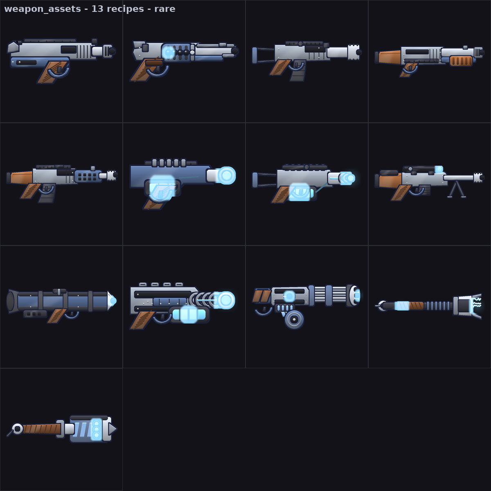
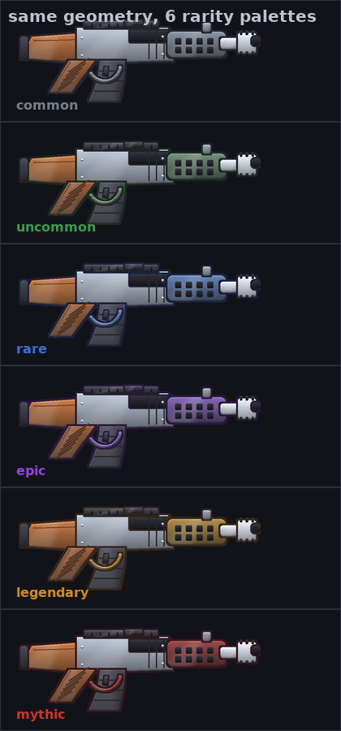
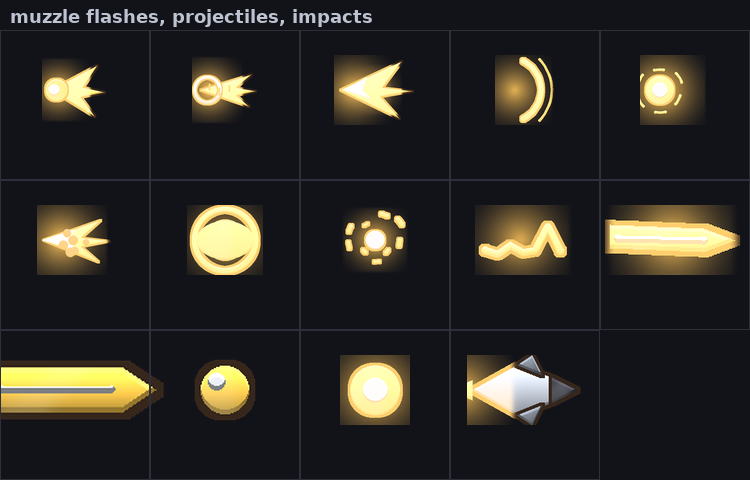

# Weapon assets

Procedural 2D weapon art + rolled stats, generated entirely in Python with Pillow.
No external art files: every sprite is vector geometry rasterised at 4x and
downsampled with LANCZOS, so the same recipe renders a 32px inventory icon and a
1024px loading-screen render.







```bash
python -m pip install -r requirements.txt

python -m weapon_assets all --out dist          # every sprite, effect, atlas, card, catalog
python -m weapon_assets render --weapons rifle --rarities rare,legendary --sizes 64,256 --out dist
python -m weapon_assets balance --level 30       # DPS table for tuning
```

`dist/` is git-ignored — regenerate it any time; the source of truth is the code.
A full `all` run (13 weapons x 6 rarities x 5 sizes x 4 variants = ~1,800 files,
plus atlas, cards and catalog) takes about three minutes on a laptop.)

---

## What you get

| Output | Detail |
|---|---|
| **13 weapons** | pistol, revolver, shotgun, smg, rifle, sniper, minigun, rocket launcher, energy pistol, plasma cannon, laser smg, shock baton, rocket hammer |
| **6 rarities** | common → mythic; each re-tints accent/energy/trim of the *same* geometry |
| **5 variants** | `side`, `side_left` (mirrored), `top_down`, `silhouette`, `outline`, plus square `icon` |
| **14 effect sprites** | 6 muzzle flashes, 6 projectiles, 2 impacts (rarity-tinted) |
| **Stats** | rolled damage/DPS/magazine/reload/crit, rarity tiers, per-level growth, perks, power score |
| **Atlas** | `atlas.png` + `atlas.json` (TexturePacker-compatible frames) |
| **Item cards** | rarity-framed inventory cards with the rolled numbers baked in |
| **Manifest** | `weapon_assets.json`: stats per rarity, palettes in hex, anchors in px **and** uv |

## Layout

```
weapon_assets/
  pen.py         anti-aliased drawing engine (outline, gradient, bevel, sheen, bloom)
  recipes.py     the 13 weapons as vector geometry + muzzle/grip anchors
  palettes.py    colour roles, colour maths, 6 rarity palettes
  catalog.py     names, classes, archetypes and base stats (designer-facing)
  stats.py       rarity/level/perk rolling, DPS + TTK maths, balance tables
  effects.py     muzzle flashes, projectiles, impacts, weapon-fx mapping
  render.py      rasterise → bloom → crop → LANCZOS; anchors; contact sheets
  export.py      files, manifest, atlas packing, item cards, naming templates
  reference.py   sample a palette out of a reference image and re-skin the set
  cli.py         command line
tests/           38 tests: `python -m unittest discover -s tests`
```

## Python API

```python
from weapon_assets import render, stats, export

# --- one sprite, with anchors for spawning projectiles -----------------------
sprite = render.render(render.RenderOptions("rifle", rarity="epic", height=256))
sprite.image.save("rifle_epic.png")
sprite.anchors_px["muzzle"]   # (247.1, 61.9)  pixels inside that PNG
sprite.anchors_uv["muzzle"]   # (0.9, 0.32)    normalised, resolution independent

# --- the rolled numbers for a drop -------------------------------------------
item = stats.build("rifle", rarity="epic", level=24, seed=1234)
item.stats.dps                # 661.4 sustained, reloads included
item.stats.ttk(100)           # seconds to kill a 100 HP target
item.power_score              # single sortable number for the UI
[perk["text"] for perk in item.perks]     # ['+8% damage', ...]

# --- a whole set + manifest ---------------------------------------------------
result = export.export_weapons("dist", rarities=["common", "rare", "legendary"],
                               sizes=[64, 256], cards=True)
export.write_manifest("dist", result.manifest)
```

### Using the anchors in an engine

The sprite is cropped tightly, so a sprite-sheet offset will *not* line up with
the barrel. Place sprites by their anchors instead:

```python
muzzle_design = sprite.anchors_uv["muzzle"]           # 0..1
px = unit.x + sprite.width  * (muzzle_design[0] - pivot_uv[0])
py = unit.y + sprite.height * (muzzle_design[1] - pivot_uv[1])
spawn_flash(px, py, rotation=unit.rotation)
```

`anchors_uv` is stable across every exported size and variant, which is exactly
what you want when the muzzle flash is a separate sprite.

## Adding a weapon

1. Write the recipe in `recipes.py` (design space is 200 x 96, bore around y=20):

```python
def railgun(p: Pen) -> None:
    p.rect((40, 14, 150, 30), radius=3, role="panel")     # receiver
    p.rect((150, 18, 190, 26), radius=2, role="steel")    # barrel
    grip(p, 70, 30, 62, 20, height=24)                    # helper: tilt+grooves
    p.glow((190, 22), 18, "energy", 0.9)                  # bloom

PAINTERS["railgun"] = railgun
ANCHORS["railgun"] = {"muzzle": (191, 22), "grip": (62, 44), "axis": 22}
```

2. Add its entry to `catalog.WEAPONS` with base stats (see any existing entry).
3. Set `"fx"` to one of the keys in `effects.FX_FLASH` (e.g. `"bolt_energy"`).
4. `python -m unittest discover -s tests` — the suite renders every catalog
   weapon, so a missing recipe or anchor fails fast.

## Tuning balance

All the knobs live at the top of `stats.py`:

```python
RARITY_MULT = {"rare": dict(damage=1.42, magazine=1.26, reload=0.92, spread=0.92, crit=1.25), ...}
PER_LEVEL   = dict(damage=0.035, magazine=0.010, crit=0.002)
MAX_LEVEL   = 60
PERK_COUNT  = {"common": 0, "rare": 2, "legendary": 4, ...}
```

Rolls are deterministic in `(slug, rarity, level, seed)`, so `seed=1234` exports
the identical gun on every machine — handy for screenshot regression.

## Re-skinning from your own art

```bash
python -m weapon_assets reference --image refs/concept.png --out dist/refskin \
       --weapons all --rarities rare
```

It samples the dominant colours, maps them to the renderer's roles (body, panel,
steel, accent, energy, grip…) and re-renders the whole set in that palette.
Override anything by hand afterwards:

```python
pal = palettes.build("legendary", accent="#ff2d55", body="#2b2f3a", energy="#7df9ff")
sprite = render.render(render.RenderOptions("smg", palette_overrides=pal.as_hex()))
```

If you have raster weapon art (PNGs/spritesheets) you want used instead of the
recipes, drop the files in and the importer in `reference.py` can be pointed at
them — the recipes and the raster path produce the same manifest shape.

## CLI reference

```
render     --weapons all --rarities common,rare --sizes 64,128,256
           --variants side,side_left,icon --template T --cards --no-glow
cards      --width 512 --height 200 --level 24
effects    --names flash_bullet,proj_plasma --sizes 32,64,128
atlas      --size 128 --variants side,icon --padding 2
sheet      --cell 256 --cols 5          # QA contact sheets
catalog    --level 12                   # stats JSON for every weapon x rarity
balance    --level 30 --out dist
all        # everything above into one folder
```

Naming template placeholders: `{kind} {slug} {rarity} {variant} {height} {level} {extra}`
(default `{kind}/{slug}/{slug}_{rarity}_{variant}_{height}px`).

## Notes & limits

- `top_down` is a *stylised* union of the profile with its mirror about the bore
  (documented in `render._top_down`). It reads correctly in a top-down game, but
  it is not authored top-down geometry — supply real top-down painters via
  `recipes.PAINTERS` if you need orthographic accuracy.
- Bloom is tuned to 0.42x by default; `glow_strength=1.0` renders it as authored.
- Rasterised designs are cached per `(slug, rarity, variant, ss, seed)`, so all
  five sizes of one weapon share a single rasterisation; `render.clear_cache()`
  drops it if you mutate palettes or recipes at runtime.
- Rendering uses `ss=4` by default; `ss=2` is roughly 4x faster and is what the
  test suite uses.
